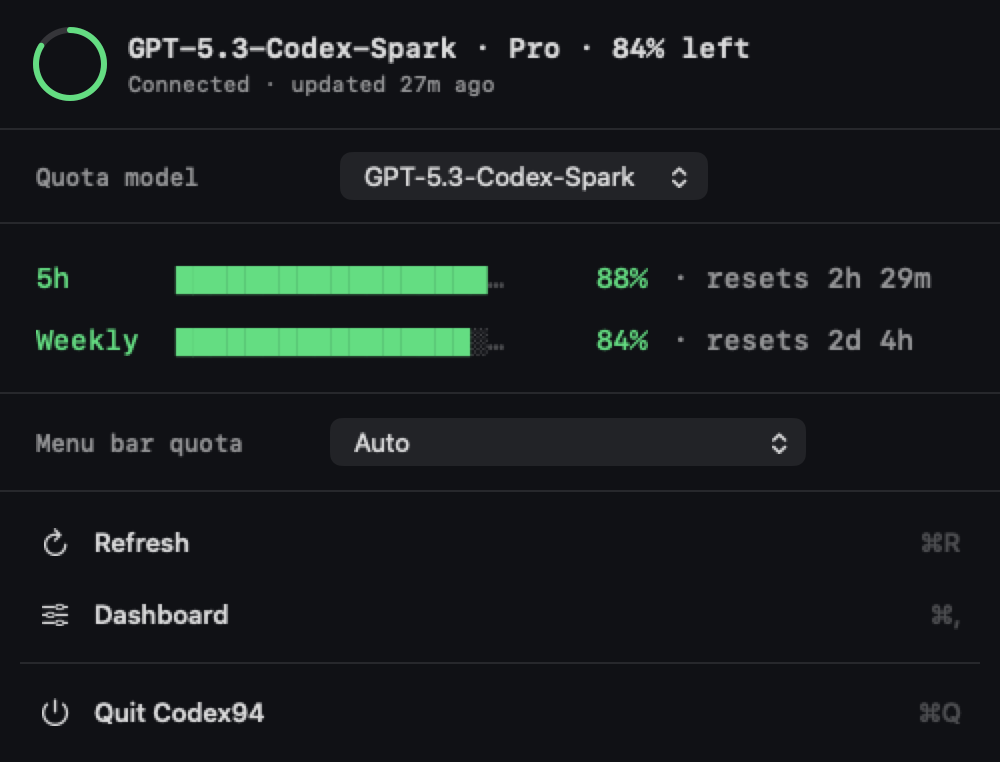
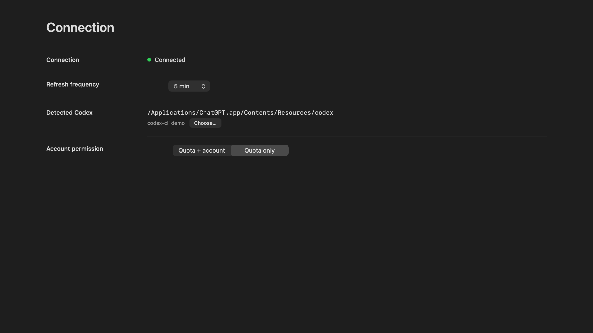

# Codex94

**English** | [简体中文](README.zh-CN.md)

Codex94 is an independent, unofficial macOS menu-bar app for **Codex and Claude
Code quota monitoring**, with **Codex Token usage statistics**. See remaining
quota, reset times and report freshness without a Dock icon; open the shared
popover, Dashboard or floating strip when you want more detail.

Codex monitoring is on by default. Claude is optional and reads Claude Code's
existing local usage reports by default; automatic Claude CLI reads are a
separate, default-off choice. The app is MIT-licensed, built with SwiftUI/AppKit,
and bundles no third-party runtime frameworks.

**Latest stable:** [`4.1.6 (30)`](https://github.com/DEFY-AN94/codex94/releases/tag/v4.1.6)
· macOS 14+ · Apple Silicon and Intel · English and Simplified Chinese

[Features](#features) · [Screenshots](#screenshots) · [Install](#installation)
· [Privacy](#security-and-privacy) · [Development](#development-and-build)
· [Changelog](CHANGELOG.md)

> Codex94 is not affiliated with, endorsed by, or sponsored by OpenAI or
> Anthropic. Codex `app-server` is experimental; upstream CLI and statusline
> formats may change. Distribution is unsigned/unnotarized as explained below.

Version 4.1.6 keeps Claude's reported model limits in Dashboard. Its popover
shows shared 5-hour and Weekly quotas by default, with a default-off Fable
switch that remembers your choice for current, cached and historical reports.
See [4.1.6 changes](CHANGELOG.md#416---2026-10-18).

## Features

The following describes the published release. Release-by-release changes live
in [CHANGELOG.md](CHANGELOG.md); validation outcomes and acceptance limits live
in the [release records](docs/RELEASING.md).

### Two services, one place to check quota

- Enable Codex and Claude independently in **Dashboard → Services**. Each keeps
  its own data source, refresh work, quota selection, failures and notification
  settings. Their percentages are never combined. Turning a service off stops
  its monitoring and reminders; a neutral status item keeps settings reachable
  when both are off.
- Choose **one service**, **compact dual rings in one menu-bar item**, or **two
  separate menu-bar items**. Either item opens the same popover, with
  a separate section for each enabled service. With Claude enabled, the quota
  area grows and shrinks with its content, scrolls when needed and keeps command
  buttons outside the scrolling area. Dashboard **Overview** shows larger
  service cards and all displayable quota buckets.
- Choose each service's menu-bar quota in **Dashboard → Display**. Current-quota
  **Auto** selects the lowest remaining percentage among available buckets and
  windows; manual choices pin one bucket/window. Codex's popover bucket browser
  is independent of that menu-bar choice.
- Show only returned **5-hour and Weekly** windows, plus Claude per-model weekly
  limits in Dashboard when reported. Claude's popover
  shows only the shared 5-hour and Weekly rows by default. Turn on its Fable
  switch to add the reported Fable row; the choice persists across restarts and
  applies to current, cached and historical reports. Other model limits remain
  in Dashboard. This display choice does not change the native menu-bar quota
  selection or fetch data. Weekly-only data is valid; missing values stay
  unknown rather than becoming `0%` or an invented quota. Default Codex quota
  and named model buckets remain separate.
- Codex's read-only **Manual quota resets** display shows the reported available
  count, including a real zero. Missing counts stay unavailable and retained
  counts are marked cached. The app has no reset-redemption action.

### Menu bar, floating window and appearance

- In single-service or separate-item modes, choose **Ring + Percentage**,
  **Percentage Only**, **Ring Only**, or a **dual-window** layout that shows one
  bucket's 5-hour and Weekly values together. Dual-window selection is saved
  separately. Compact dual-service mode uses its own pair of rings.
- Left-click or right-click toggles the popover. An optional global shortcut
  does the same; it is unset by default and must include Control or Option,
  optionally with Command and Shift. Clicking elsewhere closes the popover
  without consuming that click or requiring Accessibility permission.
- The floating quota strip supports **pin, drag, hide and expand**, and can show
  a different service from the primary menu-bar item. It reuses existing quota
  data; hover or focus its update-time control to reveal manual refresh. Its
  compact layout targets 480 × 90 logical points for weekly-only/cold data and
  680 × 90 with both windows, with screen fitting. Pin state, position
  and service choice are saved; visibility and expansion are session-only.
- Customize independent healthy, warning, critical and unavailable colors.
  Quota color thresholds remain 50% and 20%; notification thresholds are
  configured separately. Restoring colors leaves other preferences unchanged.
- Use **System, Terminal Dark or Terminal Light** appearance and **English or
  Simplified Chinese**. Dashboard size presets are 900×600, 1280×720, 1440×810
  and 1920×1080 logical points, fitted to the current screen.
- **Launch at login** is available from either supported installation location.
  **About** shows and copies the exact running version/build; **Diagnostics**
  offers a user-triggered redacted copy for troubleshooting.

### Codex quota refresh and recovery

- Read quota through the local Codex CLI. **Quota only** omits account details;
  **Quota + account** requests optional identity after quota, so a slow identity
  read does not discard valid quota. Monitoring uses the current Codex login;
  multi-account management and alternate `CODEX_HOME` directories are not supported.
- Refresh at launch and at the selected **1, 5, 15 or 30 minute** interval.
  Opening a connected popover reuses successful data less than 60 seconds old.
  Manual refresh remains available, and concurrent requests share one read.
- After wake, refresh if there is no successful snapshot or it is at least
  60 seconds old. Schedule one refresh no earlier than five seconds after the
  next future reset; clock changes and repeated targets are reconciled without
  a persistent reset ledger.
- Transient failures can retry after **5, 20 and 60 seconds**. Authentication,
  executable-discovery and malformed-data failures do not automatically retry.
  While waiting, show the failure reason and next known automatic attempt time.
- Keep the last successful quota after a failed read and mark it with an amber
  cached clock; active refresh uses a separate blue indicator. With no usable
  snapshot, show `--`. Relative data age and reset dates also appear in tooltips
  and accessibility descriptions.
- Reset details include the full local date/time and UTC offset, including
  daylight-saving changes. A fresh successful Codex report that no longer
  contains a pinned selection switches it to Auto; cached or failed reads do
  not rewrite that selection. Connection and Diagnostics actions open the
  relevant Dashboard page; signing in remains the official client's job.

### Claude sources, freshness and historical quota

Claude monitoring reads **one accepted report at a time**:

| Source | How it works |
| --- | --- |
| **Claude Code local usage cache — primary** | Reads the quota data Claude Code already fetched into its local state file. Shows shared 5-hour/weekly windows, reset times, fetch time and any per-model weekly limits. |
| **Statusline connection — backup** | Uses an eligible local report if it is newer than the cache, or the cache is absent/unreadable. Services can preview, install and remove a wrapper while preserving an existing statusline command. |
| **Official CLI `/usage` — optional** | Automatic reading is off by default and has a quota-consumption warning. **Read once with the CLI** in Services or the popover runs one explicit read regardless of that switch; it does not enable automatic reading. |

The newest valid eligible report wins, with the local cache winning ties;
percentages from different reports are never averaged or merged. Disabling
CLI reading discards only CLI data. CLI cleanup finishes before another client
can start; repeated one-time clicks do not queue extra reads.

- A local-cache report is fresh for **60 minutes** after Claude Code fetched it;
  statusline reports use **10 minutes**, and CLI reports use the larger of
  10 minutes and the refresh interval plus 60 seconds. Older reports show a
  cached marker and their original source time. Rereading a local file does
  not fetch fresh cloud usage or make its timestamp newer.
- Ordinary Claude App/web chats do not produce Claude Code statusline reports.
  Statusline quota appears only after that Code session receives an API response.
  Its account identity is unverified; a different reporting session requires
  explicit adoption. A report-stream fingerprint does not prove account identity.
- When shared windows expire, accepted data appears as **Last usage record**
  with **Current quota unknown**, original percentages and source time. The
  popover uses segmented bars; Dashboard uses large percentages and horizontal
  meters, with shared windows side by side and model limits below. Current,
  cached and historical model limits use the same meter geometry as shared
  windows, retaining their freshness labels. The popover's Fable
  switch also applies to the last usage record; Dashboard retains every reported
  model limit and the original source time.
- Compact provider rings and single-window menu-bar layouts can display this
  history with a clock and qualified tooltip. Historical Auto prefers weekly,
  then five-hour. The legacy dual-window layout stays current-only; the floating
  strip can describe history in its expanded detail while its main values stay
  unknown. History never drives current-quota notifications or reset scheduling.
- Claude report age has a separate popover line. Its five-hour row hides only
  the countdown, retaining the absolute reset time. Missing or expired windows
  are never presented as a fresh 100% remaining.
- Services explains the active source and cache state. With automatic CLI off,
  normal refresh only rereads local files; use Claude Code to obtain new data,
  or deliberately choose the warned one-time CLI action. No OAuth integration
  or direct Claude quota HTTP client is included.

### Codex Token statistics and exports

- **Dashboard → Token usage** loads service-reported summaries and daily records
  on first entry or manual statistics refresh, independently of quota polling.
  It shows lifetime tokens, peak daily tokens, current/longest streaks and the
  longest turn duration when returned. Unsupported CLI versions have a separate
  message and do not break quota monitoring.
- Switch between remembered **bar and line charts**, inspect exact values on
  hover/selection, and browse the daily table. Choose **7 days, 30 days, All
  returned or Custom** inclusive dates. Presets end at the latest reported day;
  gaps remain gaps, explicit zero stays zero, and line charts break at missing days.
- See reported average, selected-range peak and coverage, plus the preceding
  equal-length interval's total and coverage. Percentage growth requires
  complete records for both intervals and a nonzero baseline. Service summary
  cards may cover a different period; reporting timezone and complete historical
  coverage are unspecified.
- **Export CSV** saves reported dates and exact counts in the selected range.
  **Export PNG** and **Copy chart image** follow the current range, chart style,
  language and theme, including fetch time, coverage and stale-data notices but
  no identity. Copying writes to the clipboard only when clicked.
- Statistics stay in memory except for those explicit exports/copies. Refresh
  replaces a snapshot instead of accumulating it. Disabling Codex stops this
  page's data reads. Claude Token/cost analytics and model/project/input/output/
  hourly breakdowns are not provided.

### Optional alerts and manual updates

- Quota notifications are **off by default** and request macOS notification
  permission only when enabled. Default warning thresholds are **20% and 10%**
  remaining; each can be adjusted or disabled. Select additional buckets and
  recovery alerts as needed. Only fresh successful observations drive alerts;
  deduplication and baselines stay in memory.
- **About → Check for updates** reads this repository's latest public stable
  GitHub Release only when clicked. It displays the version and plain-text
  notes and can open the Release page. **Downloads and installation are manual**;
  there is no background update polling or automatic installation. Users of
  `0.2.2`, which has no update-check command, must manually install a later release.
  See [update checks and maintenance](docs/updating.md).

## Getting started

1. Install the app using one of the methods below and sign in with the official
   Codex client. On first launch, choose **Quota only** or **Quota + account**.
2. To monitor Claude, enable it in **Dashboard → Services**. Claude Code must
   already have a local usage report, for example after opening its `/usage`
   screen. Enable or install the optional sources only if you need them.
3. Choose menu-bar services in **Services**, quota/layout/colors in **Display**,
   and the floating-window service independently. Set alerts and the shortcut
   only if desired.
4. Open **Token usage** for Codex statistics. If data is missing, check source,
   report age and sign-in guidance before using **Refresh** or **Diagnostics**.

## Screenshots

All screenshots use isolated synthetic data, not a real account or live usage.
These are historical captures, not screenshots of the current 4.1.6 interface.
The chart previews were captured during `0.3.0 (14)` candidate testing and
show **Bar chart** and **Line chart** over the same seven reported days. These
original synthetic captures remain unchanged, from [CI run 35521556558](https://github.com/DEFY-AN94/codex94/actions/runs/35521556558).
The usage dates are fixed in **2033**; the zero on May 15 is an explicit fixture
value, not a filled-in missing day.

<p align="center">
  <a href="docs/images/readme/token-usage-bar-0.3.0-en.png"></a>
  <a href="docs/images/readme/token-usage-line-0.3.0-en.png"></a>
</p>
<p align="center"><strong>Token usage: switch between bars and lines</strong></p>

[View the Simplified Chinese summary cards](docs/images/readme/token-usage-overview-0.3.0-zh-Hans.png)
or inspect the [exact screenshot provenance](docs/images/readme/PROVENANCE.md).

<details>
<summary>Earlier quota interface — historical screenshots</summary>

The retained menu-bar sample is from `v0.1.7`, the popover images from `0.1.8`,
and the Dashboard Overview images from `0.1.9` GitHub-hosted CI. Their fixed
future Reset dates are synthetic test values. These files remain unchanged
and show their original interfaces, not the `0.2.2` additions or the `0.3.0`
statistics and update UI.

<p align="center">
  
</p>
<p align="center"><strong>Compact menu bar status</strong></p>

<p align="center">
  
</p>
<p align="center"><strong>CLI-style quota popover</strong></p>

<p align="center">
  
</p>
<p align="center"><strong>Quota Overview</strong></p>

</details>

## Installation

The published stable release is
[`v4.1.6 (30)`](https://github.com/DEFY-AN94/codex94/releases/tag/v4.1.6),
released on **2026-10-18** (Australia/Melbourne), with a Universal 2 DMG and source
from the same annotated tag. The download and clone instructions below use
that release; later documentation commits do not move its tag or replace assets.

The DMG is **unsigned and not notarized by Apple**. The app inside has only an
ad-hoc Hardened Runtime signature, with no Apple Developer ID. SHA-256 and
GitHub artifact attestation do not change this Apple trust status.

### Requirements

- macOS 14 or later.
- Codex monitoring requires a compatible Codex executable and a current Codex
  login.
- Optional Claude monitoring requires only a Claude Code login on this Mac that
  has fetched usage at least once (for example by opening `/usage` in a
  terminal), or an installed status-line connection. Codex94 does not complete
  Claude login or onboarding for you, and neither the cache nor the connection
  can create data that Claude Code has not fetched or reported. The CLI
  `/usage` option remains optional and off by default.

DMG installation does not require Xcode. Source installation additionally
requires full Xcode 16.4 or later (Command Line Tools alone are insufficient)
and `ripgrep` (`rg`) for the installer's static security check.

Codex94 can use a compatible CLI bundled inside `/Applications/ChatGPT.app`
or `/Applications/Codex.app`, so a standalone CLI installation is not required.
It checks the newer `Contents/Resources/codex-cli/CodexCLI.app/Contents/MacOS/codex`
locations before the legacy `Contents/Resources/codex` paths, then retains
Homebrew and standard CLI fallbacks. Explicit manual-path selection keeps its
precedence; an invalid manual choice is not silently bypassed.

### Install the Universal DMG

Download both stable assets from the
[`v4.1.6` release page](https://github.com/DEFY-AN94/codex94/releases/tag/v4.1.6):

- `Codex94-4.1.6-macos-universal-unnotarized.dmg`
- `Codex94-4.1.6-SHA256SUMS.txt`

The DMG supports Apple Silicon (`arm64`) and Intel (`x86_64`) on macOS
14 or later. Verify the checksum before opening it:

```bash
shasum -a 256 -c Codex94-4.1.6-SHA256SUMS.txt
```

If you have the GitHub CLI, verify that the exact DMG came from this
repository's GitHub workflow and commit:

```bash
gh attestation verify Codex94-4.1.6-macos-universal-unnotarized.dmg \
  -R DEFY-AN94/codex94 \
  --signer-workflow DEFY-AN94/codex94/.github/workflows/ci.yml \
  --source-ref refs/heads/main \
  --source-digest deddba6242440cd668bf218d8babd0e64dddfdf0 \
  --deny-self-hosted-runners
```

Attestation is build provenance, not an Apple signature, notarization, malware
review, or Gatekeeper approval.

Quit every running Codex94 copy, open the DMG, and drag `Codex94.app` onto its
`Applications` shortcut. This installs it at `/Applications/Codex94.app`. Do
not run that copy at the same time as a copy in `~/Applications`; both use the
same bundle identifier, preferences, cache, and login-item registration.

Because this technical-user DMG is unsigned and unnotarized, macOS may block
opening it or the first App launch. If you trust the exact verified release,
follow Apple's official
[Privacy & Security → Open Anyway](https://support.apple.com/guide/mac-help/open-a-mac-app-from-an-unknown-developer-mh40616/26/mac/26)
flow. Do not remove quarantine attributes or disable Gatekeeper.

### Install from source

This public repository needs no GitHub authentication. Clone the published
stable source tag:

```bash
git clone --branch v4.1.6 --depth 1 https://github.com/DEFY-AN94/codex94.git
```

Then build the selected tag:

```bash
cd codex94
brew install ripgrep

sudo xcodebuild -license accept
sudo xcodebuild -runFirstLaunch

./script/install.sh
```

Quit all Codex94 copies before installing. The installer locks the destination,
verifies a unique staged copy and retains the old app for rollback until replacement
succeeds. If rollback fails, recovery files remain; it does not keep a version archive.
The installer builds, signs, installs, and opens `~/Applications/Codex94.app`.
Pass `--no-launch` to install without opening it:

```bash
./script/install.sh --no-launch
```

On first launch, choose whether Codex94 may request **Quota + account** or
**Quota only**. Launch at login accepts exactly the stable
`/Applications/Codex94.app` and `~/Applications/Codex94.app` locations. The
source installer does not migrate or remove a DMG-installed copy.

## Security and privacy

- **Authentication stays in the official clients.** Codex94 starts Codex with
  `codex -s read-only -a never app-server --stdio` and uses local stdio JSON-RPC
  for quota and Token summaries. Codex owns its login and network access.
  The optional Claude CLI owns its own authentication. Codex94 does not read
  credential files, browser cookies, Keychain entries, session logs or SQLite
  databases, and does not implement OAuth or direct quota HTTP requests.
- **Claude local data is read-only and bounded.** The cache reader opens
  `~/.claude.json` (or the location selected by Codex94's own `CLAUDE_CONFIG_DIR`)
  read-only, rejecting symlinks, hard links, foreign owners, non-regular files
  and files over 16 MiB. It interprets only `cachedUsageUtilization`; other
  decoded fields are discarded. An account UUID is compared only in memory to
  detect a login change and is never stored, logged or exported. Installing or
  removing the optional statusline connection explicitly changes that setting,
  preserves recovery material and checks for conflicts before restoration.
- **Local storage is limited.** The owner-only Codex cache contains quota
  buckets, plan/window metadata, percentages, resets and fetch time. Email is
  memory-only in account mode and removed when switching to quota-only mode.
  Interface choices are saved locally; notification baselines, reset credits
  and Token snapshots stay in memory. Explicit CSV/PNG exports and clipboard
  copies are user-directed outputs. Notification Center may retain delivered
  quota messages, which omit email.
- **No telemetry or automatic updater.** There is no analytics, advertising,
  crash-reporting SDK, system profiling or project-operated server. The sole
  direct network client is the user-triggered public GitHub release check,
  which sends no account or usage data. Release-page navigation belongs to the
  system browser. The app never reads or uploads the clipboard or diagnostics;
  review copied diagnostics before sharing.
- **Trust the executable you select.** App Sandbox is disabled so the Codex
  subprocess can access its own login. Hardened Runtime, fixed arguments,
  minimal environment, bounded output, deadlines and process-group cleanup
  remain in place. CLI version validation checks compatibility, not publisher
  identity. Release packages exclude account data, preferences, caches and logs.

See [PRIVACY.md](PRIVACY.md) and [SECURITY.md](SECURITY.md) for the full storage,
process, network and distribution boundaries and private vulnerability reporting.

## Development and build

Contributor and release checks also require `jq`:

```bash
brew install ripgrep jq
```

Run `python3 -I script/codex_prepare.py` at the start of a development task.
It leaves complete checkouts unchanged and attempts a bounded fetch from
`origin` when history is shallow. Resolve any preparation failure before
relying on a history scan; see [Codex setup](docs/CODEX.md) for local-session
hooks and Cloud Start skill configuration.

Since 4.1.5, `script/security_check.sh` requires complete Git history for
contributor and release checks. In a shallow clone it stops and asks for
`git fetch --unshallow`. Only `install.sh` explicitly permits shallow history
for source installation, prints the limited scan scope and scans the fetched
commits. Do not use that installer exception for development or release checks.

Build and run a Debug app:

```bash
./script/build_and_run.sh
```

`build_and_run.sh` stops existing named Codex94 processes before building and
launches the Debug app. `install.sh` asks you to quit running
copies instead of stopping them, replaces only its installation path, and may
launch the installed App. These scripts are not read-only checks; local app runs can
use the same preferences and cache as the installed app.

Use synthetic fixtures and injected fetchers or an explicit fake executable
for automated tests and documentation screenshots. Do not include real account
credentials, identity, quota, or private paths in shared fixtures or artifacts.
Keep test preferences and cache separate from daily app data; see
[CONTRIBUTING.md](CONTRIBUTING.md).

Run the unit and fake app-server integration tests:

```bash
DEVELOPER_DIR=/Applications/Xcode_16.4.app/Contents/Developer \
  xcodebuild -project Codex94.xcodeproj -scheme Codex94 \
  -destination 'platform=macOS' -derivedDataPath .build/DerivedData \
  CODE_SIGNING_ALLOWED=NO test
```

Run the complete release gate, including isolated metadata/installer tests,
hosted tests, one Universal Release build, and DMG create/verify.
`script/release_metadata.py` reads the App target's version/build; CI and the
UI fixture use the committed values. The packager owns the complete App
signature and payload validation:

```bash
./script/release_check.sh
```

For Codex contributors, see [Codex setup and session hooks](docs/CODEX.md).
Build and test requirements, safe fixtures and contribution rules are in
[CONTRIBUTING.md](CONTRIBUTING.md); component ownership is in
[ARCHITECTURE.md](docs/ARCHITECTURE.md). This project is **vibe-built with Codex**,
with maintainer review, testing and security checks before each release.

Historical test counts and release changes belong in [CHANGELOG.md](CHANGELOG.md).
Exact CI runs, candidate identities, artifact hashes, installation outcomes and
validation limits belong in [RELEASING.md](docs/RELEASING.md). Old screenshots or
passing tests are not evidence of a new release's native keyboard, Spaces,
fullscreen or Gatekeeper behavior.

## Uninstall

If you installed the Claude statusline connection, disconnect it in **Services**
while Codex94 is still installed. This restores the previous command before its
helper executable is removed. Then disable **Launch at login** in Dashboard and quit every Codex94 copy.
Remove only the App locations that you actually installed; neither installer
automatically removes the other copy:

```bash
rm -rf "/Applications/Codex94.app"
rm -rf "$HOME/Applications/Codex94.app"
```

Removing the App does not remove its local data. To remove that too, separately
delete the cache and preferences:

```bash
rm -rf "$HOME/Library/Application Support/Codex94"
defaults delete com.defyan94.codex94
```

## License

Codex94 is licensed under the [MIT License](LICENSE). See
[ATTRIBUTIONS.md](ATTRIBUTIONS.md) for design and implementation references.

Codex and ChatGPT are trademarks of OpenAI. Codex94 is an independent,
unofficial project and does not use the OpenAI logo.
