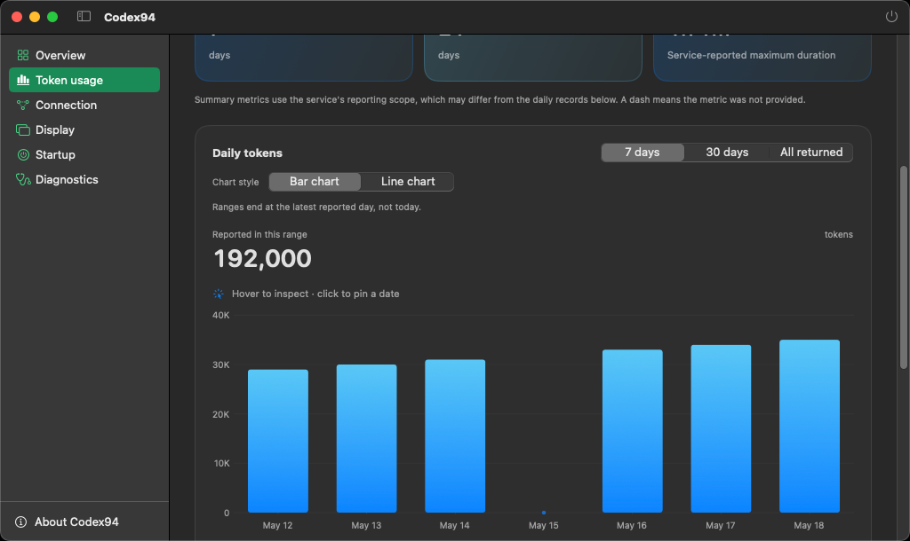
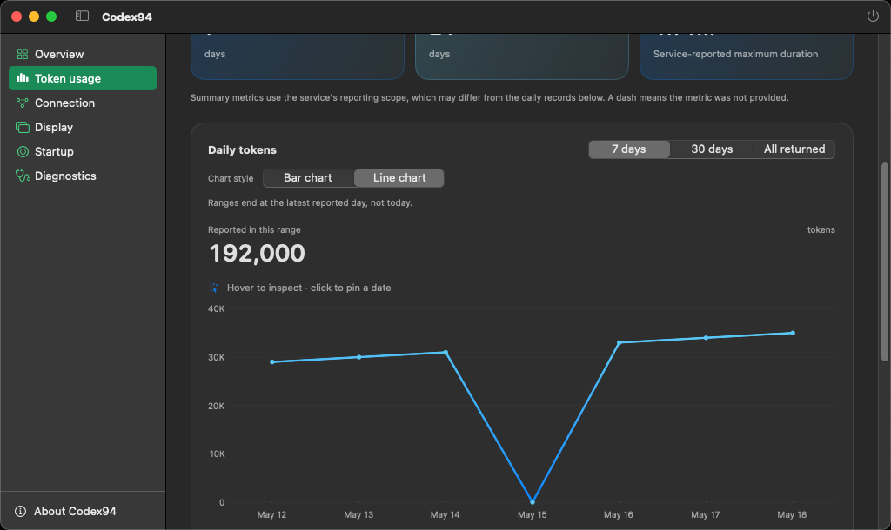
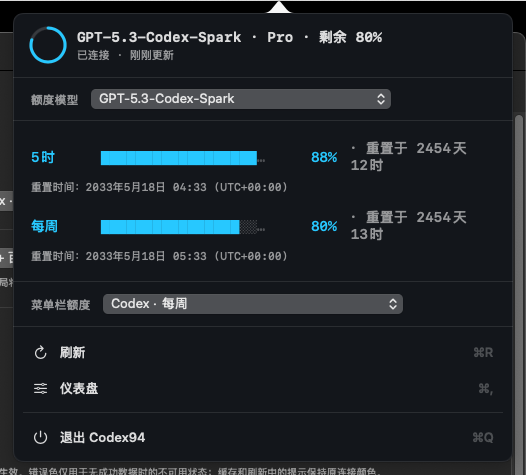
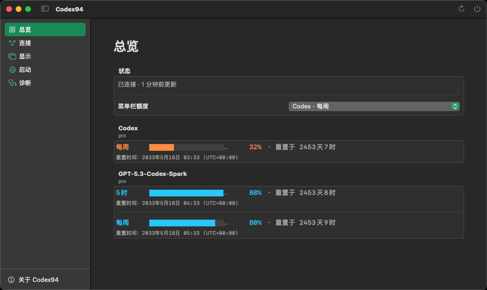

# Codex94

[English](README.md) | **简体中文**

Codex94 是独立、非官方的 macOS 菜单栏工具，用于 **Codex 与 Claude Code 额度监控**，
并提供 **Codex Token 用量统计**。无需占用 Dock 即可查看剩余额度、重置时间与数据新鲜度，
再通过同一个弹出面板、Dashboard 或悬浮条查看详情。

默认开启 Codex 监控。Claude 可选启用，默认读取 Claude Code 已有的本地用量报告；
自动调用 Claude CLI 是独立且默认关闭的选项。项目采用 MIT 许可，以 SwiftUI/AppKit 构建，
不捆绑第三方运行时框架。

**最新稳定版：**[`4.1.4 (28)`](https://github.com/DEFY-AN94/codex94/releases/tag/v4.1.4)
· macOS 14+ · Apple Silicon 与 Intel · English 与简体中文

[功能详情](#功能详情) · [界面截图](#界面截图) · [安装](#安装)
· [安全与隐私](#安全与隐私) · [开发](#开发与构建) · [更新记录](CHANGELOG.md)

> Codex94 与 OpenAI 或 Anthropic 没有隶属关系，也未获其认可、背书或赞助。
> Codex `app-server` 为实验性接口，上游 CLI 与状态栏数据格式可能变化。
> 分发包未签名／未公证，具体信任边界见下方安装说明。

尚未发布的源码版本还会在 Dashboard 中以大百分比和横向进度条展示 Claude 历史额度；
详见 [Unreleased 更新记录](CHANGELOG.md#unreleased)。

## 功能详情

以下介绍当前稳定版的完整使用能力。逐版变更集中在 [CHANGELOG.md](CHANGELOG.md)，
候选版本检查和安装验收证据集中在[发布记录](docs/RELEASING.md)。

### 两种服务，统一查看额度

- 在 **Dashboard → 服务**中独立启用 Codex 和 Claude。两者分别维护来源、刷新任务、
  额度选择、错误和通知设置，不合并百分比。关闭服务会停止其监控与提醒；全部关闭时仍保留
  中性菜单栏项，方便返回设置。
- 菜单栏可显示**单个服务**、**一个状态项中的紧凑双圈**，或**两个独立状态项**。
  点击任一项都会打开同一个可滚动面板，按服务分区展示；Dashboard **总览**使用较大的
  服务卡片展示全部可显示额度桶。
- 在 **Dashboard → 显示**中选择各服务的菜单栏额度。当前额度的**自动**模式选取可用
  额度桶与窗口中剩余比例最低的一项，也可手动固定。Codex 弹窗中的额度桶浏览器独立于
  菜单栏选择，浏览模型不会改变菜单栏显示。
- 只显示实际返回的 **5 小时、每周**窗口，以及 Claude 报告的按模型周限额。仅有周额度也
  是有效数据；缺失值保持未知，不伪造成 `0%` 或推算额度。Codex 默认额度与命名模型桶
  分开处理。
- Codex 的只读**手动额度重置**区域显示实际可用次数，包括真实的零。缺失值显示不可用，
  保留的旧值标注缓存；App 不提供兑换重置次数的操作。

### 菜单栏、悬浮窗与外观

- 单服务或两个独立状态项模式支持**圆环 + 百分比**、**仅百分比**、**仅圆环**和**双窗口**
  布局。双窗口同时显示一个额度桶的 5 小时与每周数值，单独保存选桶偏好；紧凑双服务模式
  使用自己的双圈布局。
- 鼠标左键、右键或自定义全局快捷键都切换同一个弹窗。快捷键默认未设置，必须含 Control
  或 Option，也可加入 Command、Shift。点击外部会收起弹窗，不吞掉原点击，也不要求
  辅助功能权限。
- 悬浮额度条支持**置顶、拖动、隐藏和展开**，可独立选择服务，不必跟随主菜单栏项。它复用
  已有额度数据，悬停或聚焦更新时间控件可显示手动刷新。仅周额度／无数据时目标为
  480 × 90 逻辑点，双窗口时为 680 × 90，并适配屏幕。置顶、位置及服务选择会保存，
  显示和展开状态仅在本次运行中保留。
- 分别自定义充足、偏低、紧张和无可用数据时的错误颜色。额度颜色阈值固定为 50% 和 20%，
  与通知阈值独立；恢复默认颜色不会改变其他偏好。
- 支持**跟随系统、Terminal Dark、Terminal Light**外观及 **English、简体中文**。
  Dashboard 提供 900×600、1280×720、1440×810、1920×1080 逻辑点预设，并适配当前屏幕。
- 两个受支持的安装位置都可设置**登录时启动**。**关于**页展示并复制实际运行的版本与 build；
  **诊断**页可按用户操作复制经过脱敏的信息。

### Codex 额度刷新与恢复

- 通过本机 Codex CLI 读取额度。**仅额度**模式不请求账号详情；**额度 + 账号信息**先读取
  额度，再读取可降级的身份信息，身份读取较慢不会丢弃有效额度。只使用当前 Codex 登录，
  不管理多账号或其他 `CODEX_HOME` 目录。
- 启动时及所选的 **1、5、15 或 30 分钟**间隔刷新。连接正常且成功数据不足 60 秒时，
  打开弹窗直接复用已有结果；也可手动刷新，同时发起的请求共用一次读取。
- Mac 唤醒后，若没有成功快照或数据已超过 60 秒则刷新。下次未来重置时间至少过去 5 秒后
  安排一次刷新，协调时钟变化与重复目标，不保存持久化重置账本。
- 短暂失败后可分别等待 **5、20、60 秒**重试；认证、可执行文件发现及畸形数据错误不自动重试。
  等待期间保留失败原因，并在已知时显示下次自动尝试时间。
- 刷新失败时保留最后成功额度，以琥珀色缓存时钟标记；刷新中使用独立蓝色提示。没有可用
  快照时显示 `--`。数据年龄、重置信息同样出现在提示和辅助功能描述中。
- 重置详情包含本地完整日期、时间及该时刻的 UTC 偏移，正确处理夏令时。Codex 的新成功
  报告确认固定选项已消失时，选择改为自动；缓存与失败不会改写选择。连接设置和诊断按钮
  打开相应 Dashboard 页面；登录仍由官方客户端完成。

### Claude 来源、新鲜度与历史额度

Claude 监控每次只显示**一份已接受的报告**：

| 来源 | 工作方式 |
| --- | --- |
| **Claude Code 本地用量缓存 — 主来源** | 读取 Claude Code 已获取并写入本地状态文件的额度，包含共享的 5 小时／每周窗口、重置时间、获取时间和已报告的按模型周限额。 |
| **状态栏连接 — 备用来源** | 在符合条件的报告比缓存更新，或缓存不存在／无法读取时使用。服务页可预览、安装、移除 wrapper，保留既有状态栏命令。 |
| **官方 CLI `/usage` — 可选** | 自动读取默认关闭，并提示可能消耗额度。服务页或弹窗的**用 CLI 刷新一次**可独立执行一次，既不依赖也不开启自动读取开关。 |

符合条件的最新有效报告优先，时间相同时缓存胜出；不对不同报告取平均或拼接百分比。
关闭 CLI 读取只丢弃 CLI 数据。旧 CLI 清理结束后才能启动新客户端，重复点击单次按钮
不会排队追加读取。

- 本地缓存以 Claude Code 取数时间为准，**60 分钟**内视为新鲜；状态栏为 **10 分钟**，
  CLI 为 10 分钟与“刷新间隔加 60 秒”中的较大值。更旧的数据保留原来源时间并显示缓存标记。
  重读本地文件不会获取新云端用量，也不会把报告时间改为现在。
- 普通 Claude App／网页聊天不会生成 Claude Code 状态栏报告；Code 会话收到 API 响应后
  才会产生相应额度字段。状态栏账号身份未经验证，换报告会话需明确采用；报告流指纹
  不能证明账号身份一致。
- 共享窗口过期后，已接受的数据会显示为**上次用量记录**，明确标注**当前额度未知**，
  保留原百分比与获取时间。弹窗采用分段进度条，Dashboard 保留历史文字视图。
- 紧凑双圈及单窗口菜单栏样式可显示带小钟和说明的历史额度；历史自动选择优先每周、
  其次 5 小时。旧双窗口布局只显示当前额度；悬浮条主数值仍为未知，展开详情可说明历史。
  历史数据不参与当前额度通知或重置调度。
- Claude 报告年龄在弹窗中单独显示；5 小时额度行只隐藏倒计时，绝对重置时间仍保留。
  缺失或过期窗口不会被当作新的“剩余 100%”。
- 服务页解释当前来源与缓存状态。自动 CLI 关闭时，普通刷新只重读本地文件；新数据需要
  Claude Code 获取，或由你主动使用带提示的单次 CLI 操作。没有 OAuth 集成或直接的
  Claude 额度 HTTP 客户端。

### Codex Token 统计与导出

- **Dashboard → Token 统计**在首次进入或手动刷新统计时加载服务端汇总和日记录，
  与额度轮询独立。按实际返回显示累计 Token、单日峰值、当前／最长连续使用天数和最长
  单次运行时长。不支持统计的 CLI 版本有单独提示，不影响额度监控。
- **柱状图／折线图**选择会记住，可悬停或选中查看精确值，也可浏览日明细表。支持
  **7 天、30 天、全部返回、自选日期**，自选包含起止日。预设截至最新已报告日期；缺口
  保持缺口，真实零仍为零，折线在缺失日期处断开。
- 展示已报告日均、所选区间峰值、覆盖率，以及前一等长区间的合计与覆盖情况。仅两段数据
  完整且基期非零时计算增长百分比。服务端汇总卡可能覆盖不同区间，分日时区与完整历史
  覆盖范围尚无说明。
- **导出 CSV**保存所选区间已返回的日期与精确数量；**导出 PNG**、**复制图表图片**沿用
  当前范围、样式、语言与主题，包含获取时间、覆盖率和旧数据提示，不含身份。复制仅在
  点击后写入剪贴板。
- 除主动导出／复制外，统计只在内存中保存，刷新替换快照而非重复累加。关闭 Codex 会停止
  该页读取。不提供 Claude Token／费用分析，也不推算按模型、项目、输入／输出或小时细分。

### 可选提醒与手动更新

- 额度通知**默认关闭**，启用时才请求 macOS 通知权限。剩余比例默认在 **20%、10%** 时提醒，
  各档均可调整或关闭，也可选择额外额度桶和恢复提醒。只有新鲜的成功观测驱动通知，
  基线与去重仅在内存中保存。
- **关于 → 检查新版本**只在点击后读取本仓库最新公开稳定 GitHub Release，显示版本与
  纯文本说明，并可打开发布页面。**下载与安装由用户手动完成**，不后台轮询或自动安装。
  `0.2.2` 没有更新检查入口，需要先手动安装后续版本；详见[更新检查与维护](docs/updating.md)。

## 开始使用

1. 按下方方式安装，并先在官方 Codex 客户端登录。首次启动选择**仅额度**或**额度 + 账号信息**。
2. 需要 Claude 时，在 **Dashboard → 服务**启用。Claude Code 必须已有本地用量报告，
   例如曾打开自己的 `/usage` 页面；按需要选择或安装其他可选来源。
3. 在**服务**页选择菜单栏服务，在**显示**页选择额度、布局与颜色；悬浮窗服务独立设置。
   通知与快捷键按需要开启。
4. 在 **Token 统计**查看 Codex 用量。遇到空数据时先检查来源、报告年龄和登录提示，再使用
   **刷新**或**诊断**。

## 界面截图

所有截图均采用隔离的合成数据，不包含真实账号或实时用量。以下为历史截图，不代表当前 4.1.4 的界面。
以下**柱状图**与**折线图**采集于 `0.3.0 (14)` 候选测试阶段，使用相同的七天日记录。
原始合成截图保持不变，
这些英文界面截图来自
[CI run 35521556558](https://github.com/DEFY-AN94/codex94/actions/runs/35521556558)，
未编辑媒体内容。统计日期固定在 **2033 年**；5 月 15 日的零是夹具明确返回的数值，
不是为缺失日期补零。

<p align="center">
  <a href="docs/images/readme/token-usage-bar-0.3.0-en.png"></a>
  <a href="docs/images/readme/token-usage-line-0.3.0-en.png"></a>
</p>
<p align="center"><strong>Token 统计：自由切换柱状图与折线图</strong></p>

[查看简体中文汇总卡截图](docs/images/readme/token-usage-overview-0.3.0-zh-Hans.png)，
或查看[精确的截图来源记录](docs/images/readme/PROVENANCE.md)。

<details>
<summary>既有额度界面——历史版本截图</summary>

保留的菜单栏示例来自 `v0.1.7`，Popover 图片来自 `0.1.8`，Dashboard 总览图片来自
`0.1.9` 的 GitHub-hosted CI。图中固定的未来 Reset 日期均为合成测试值。原文件保持
不变，只展示各自版本的界面，不代表 `0.2.2` 新增功能或 `0.3.0` 的统计与更新界面。

<p align="center">
  
</p>
<p align="center"><strong>紧凑菜单栏状态</strong></p>

<p align="center">
  
</p>
<p align="center"><strong>CLI 风格额度面板</strong></p>

<p align="center">
  
</p>
<p align="center"><strong>额度总览</strong></p>

</details>

## 安装

已发布稳定版为 [`v4.1.4 (28)`](https://github.com/DEFY-AN94/codex94/releases/tag/v4.1.4)，
于 **2026-10-07**（Australia/Melbourne）发布，提供 Universal 2 DMG 与同一个 annotated 标签
的源码。下方下载和 clone 指令指向该版本；后续文档提交不会移动标签或替换已发布资产。

DMG **未签名，也未经过 Apple 公证**。内部 App 只有 ad-hoc Hardened Runtime 签名，
没有 Apple Developer ID；SHA-256 与 GitHub artifact attestation 不会改变其 Apple 信任状态。

### 系统要求

- macOS 14 或更高版本。
- Codex 监控需要兼容的 Codex 可执行文件和当前登录状态。
- 可选 Claude 监控只需要本机已登录的 Claude Code 至少获取过一次用量（例如在终端中
  打开 `/usage`），或已安装状态栏连接。Codex94 不代为完成 Claude 登录或首次引导；
  缓存和连接都不会凭空生成 Claude Code 未获取或未报告的数据。CLI `/usage` 选项仍为
  可选且默认关闭。

使用 DMG 安装不需要 Xcode。源码安装还需要完整版 Xcode 16.4 或更高版本
（仅有 Command Line Tools 不够），以及安装脚本静态安全检查使用的
`ripgrep`（`rg`）。

Codex94 可以使用 `/Applications/ChatGPT.app` 或 `/Applications/Codex.app`
中的兼容 Codex CLI，无需另装独立 CLI。它先检查新版
`Contents/Resources/codex-cli/CodexCLI.app/Contents/MacOS/codex` 路径，再检查旧
`Contents/Resources/codex` 路径，并保留 Homebrew 与常见 CLI 位置回退。显式手动
路径仍有最高优先级；无效的手动选择不会被悄悄绕过。

### 安装 Universal DMG

请从 [`v4.1.4` Release 页面](https://github.com/DEFY-AN94/codex94/releases/tag/v4.1.4)
下载以下两个正式资产：

- `Codex94-4.1.4-macos-universal-unnotarized.dmg`
- `Codex94-4.1.4-SHA256SUMS.txt`

DMG 支持 Apple Silicon（`arm64`）与 Intel（`x86_64`），最低系统为 macOS 14。
打开前先验证 checksum：

```bash
shasum -a 256 -c Codex94-4.1.4-SHA256SUMS.txt
```

如已安装 GitHub CLI，还可验证该 DMG 来自本仓库的 GitHub workflow 与提交：

```bash
gh attestation verify Codex94-4.1.4-macos-universal-unnotarized.dmg -R DEFY-AN94/codex94
```

Attestation 只证明构建来源，不代表 Apple 签名、公证、恶意软件审查或 Gatekeeper 认可。

先退出所有正在运行的 Codex94，再打开 DMG，把 `Codex94.app` 拖到其中的
`Applications` 快捷方式，安装位置是 `/Applications/Codex94.app`。不要同时运行
这里的副本和 `~/Applications` 中的副本；两者共用同一个 bundle identifier、
偏好、缓存与登录项注册。

由于此技术用户 DMG 未签名且未公证，macOS 可能阻止打开 DMG 或首次启动 App。
若你信任已经精确核验的该版本，请遵循 Apple 官方的
[“隐私与安全性 → 仍要打开”](https://support.apple.com/guide/mac-help/open-a-mac-app-from-an-unknown-developer-mh40616/26/mac/26)
流程。不要删除 quarantine 属性，也不要关闭 Gatekeeper。

### 从源码安装

仓库公开，无需 GitHub 认证。Clone 当前已发布的稳定源码标签：

```bash
git clone --branch v4.1.4 --depth 1 https://github.com/DEFY-AN94/codex94.git
```

然后构建所选标签：

```bash
cd codex94
brew install ripgrep

sudo xcodebuild -license accept
sudo xcodebuild -runFirstLaunch

./script/install.sh
```

安装前请先退出所有 Codex94 副本。安装器持有安装锁，验证独立暂存副本，并在替换成功前
保留旧 App 以便回滚；回滚失败时保留恢复文件，但不维护版本归档。脚本会构建、签名、安装并打开
`~/Applications/Codex94.app`。如需安装后不自动打开：

```bash
./script/install.sh --no-launch
```

首次启动时，可以选择允许 Codex94 请求 **额度 + 账号信息** 或 **仅额度**。
登录时启动精确接受 `/Applications/Codex94.app` 与
`~/Applications/Codex94.app` 两个稳定位置。源码安装脚本不会迁移或删除 DMG
安装的副本。

## 安全与隐私

- **认证留在官方客户端。** Codex94 通过固定命令
  `codex -s read-only -a never app-server --stdio` 与本地 stdio JSON-RPC 请求额度和
  Token 汇总，由 Codex 管理登录与联网；可选 Claude CLI 同样自行管理认证。Codex94
  不读取凭据文件、浏览器 cookie、Keychain、会话日志或 SQLite 数据库，也不实现 OAuth
  或直接的额度 HTTP 请求。
- **Claude 本地数据只读且有边界。** 缓存读取器只读打开 `~/.claude.json`，或 Codex94 自身
  `CLAUDE_CONFIG_DIR` 指定的位置；拒绝符号链接、硬链接、非当前用户所有、非常规文件及
  大于 16 MiB 的文件。只解释 `cachedUsageUtilization`，丢弃其他已解码字段。账号 UUID
  仅在内存中比较以识别换号，不存储、记录或导出。安装／移除可选状态栏连接会明确修改该项
  设置，保留恢复材料，并在恢复前检查冲突。
- **限制本地存储。** 仅当前用户可读的 Codex 缓存保存额度桶、套餐／窗口信息、百分比、
  重置与获取时间。账号模式的邮箱仅在内存中，切换仅额度时移除。界面偏好本地保存；通知
  基线、重置次数和 Token 快照留在内存。CSV／PNG 导出和剪贴板复制由用户主动触发；
  macOS 通知中心可保存已送达的额度消息，消息不含邮箱。
- **没有遥测或自动更新器。** 不含分析、广告、崩溃上报 SDK、系统信息统计或项目自营服务器。
  唯一直接网络客户端用于用户主动的公开 GitHub 更新检查，不发送账号或用量数据；发布
  页面由系统浏览器打开。App 不读取或上传剪贴板和诊断，分享前仍应检查复制的诊断内容。
- **需要信任所选可执行文件。** 为允许 Codex 子进程访问自身登录状态，App Sandbox 关闭；
  保留 Hardened Runtime、固定参数、最小环境、输出上限、超时与进程组清理。CLI 版本检查
  验证兼容性，不证明发布者身份。分发包不含账号数据、偏好、缓存或日志。

完整的存储、进程、网络、分发边界和私密漏洞报告方式见 [PRIVACY.md](PRIVACY.md) 与
[SECURITY.md](SECURITY.md)（英文）。

## 开发与构建

贡献与发布检查还需要 `jq`：

```bash
brew install ripgrep jq
```

此开发分支中的 `script/security_check.sh` 要求贡献与发布检查使用完整 Git 历史；浅克隆会
报错并提示先执行 `git fetch --unshallow`。仅 `install.sh` 为源码安装明确允许浅历史，
同时提示扫描范围有限，只检查已下载的提交。这项保护与安装提示仍属未发布改动；
上方稳定版 `v4.1.4` 标签仍保留原扫描脚本。

构建并运行 Debug App：

```bash
./script/build_and_run.sh
```

`build_and_run.sh` 会在构建前关闭现有的匹配名称 Codex94 进程，然后启动 Debug
App。`install.sh` 会要求用户自行退出正在运行的副本，仅替换自身安装路径，
并且可能启动安装后的 App。这些脚本并非只读检查；
本机运行的 App 可能使用与已安装 App 相同的偏好和缓存。

自动测试和文档截图应使用合成数据、注入 fetcher 或显式指定的 fake executable。
不要在共享夹具或产物中包含真实账号凭证、身份、额度或私人路径。测试偏好与缓存
应与日常 App 数据分开；详见 [CONTRIBUTING.md](CONTRIBUTING.md)（英文）。

运行单元测试与 fake app-server 集成测试：

```bash
DEVELOPER_DIR=/Applications/Xcode_16.4.app/Contents/Developer \
  xcodebuild -project Codex94.xcodeproj -scheme Codex94 \
  -destination 'platform=macOS' -derivedDataPath .build/DerivedData \
  CODE_SIGNING_ALLOWED=NO test
```

运行完整发布检查，包括隔离的 metadata/installer 脚本测试、hosted tests、一次
Universal Release 构建和 DMG create/verify。`script/release_metadata.py` 统一读取
App target 的版本与 build，CI 与 UI fixture 使用 committed 值；完整 App 签名与
payload 验证由打包脚本负责：

```bash
./script/release_check.sh
```

Codex 贡献者请参阅 [Codex 设置与会话 Hook](docs/CODEX.md)。构建测试要求、合成夹具和
贡献规则见 [CONTRIBUTING.md](CONTRIBUTING.md)，组件职责见
[ARCHITECTURE.md](docs/ARCHITECTURE.md)。本项目采用 **Codex 辅助的 vibe coding** 工作流，
每次发布前仍由维护者审阅，并执行测试和安全检查。

历史测试数量与逐版变更集中在 [CHANGELOG.md](CHANGELOG.md)。准确的 CI 运行、候选提交、
产物哈希、安装结果和验证限制见 [RELEASING.md](docs/RELEASING.md)。旧截图或通过的测试
不能替代新版本的原生键盘、Spaces、全屏或 Gatekeeper 验证。

## 卸载

如果安装过 Claude 状态栏连接，请先在 **服务**中断开连接，在辅助程序被删除前
恢复原有命令。然后在 Dashboard 中关闭 **登录时启动**，退出所有 Codex94 副本。只删除你实际
安装过的位置；两种安装方式都不会自动删除另一个副本：

```bash
rm -rf "/Applications/Codex94.app"
rm -rf "$HOME/Applications/Codex94.app"
```

删除 App 不会删除本地数据。如需同时移除本地缓存与偏好，请再单独执行：

```bash
rm -rf "$HOME/Library/Application Support/Codex94"
defaults delete com.defyan94.codex94
```

## 许可

Codex94 使用 [MIT License](LICENSE)。设计与实现参考见
[ATTRIBUTIONS.md](ATTRIBUTIONS.md)（英文）。

Codex 和 ChatGPT 是 OpenAI 的商标。Codex94 是独立的非官方项目，不使用
OpenAI Logo。
